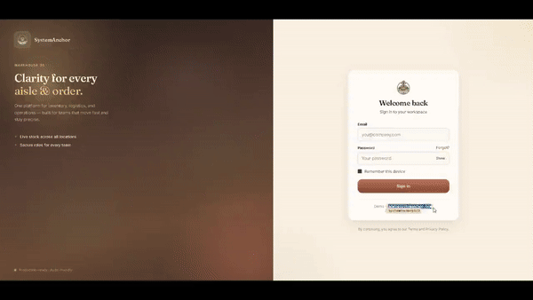
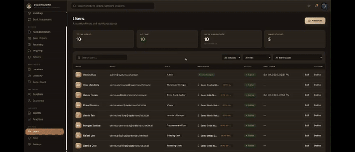
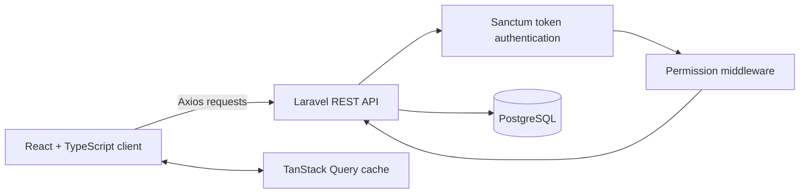

# SystemAnchor

SystemAnchor is a full-stack warehouse management system for recording products, stock activity, purchasing, receiving, sales fulfillment, and warehouse access. The React and TypeScript client communicates with a Laravel REST API backed by PostgreSQL.

## Project Overview

The application manages products, categories, suppliers, customers, warehouses, purchase orders, goods receipts, sales orders, shipments, returns, stock movements, users, roles, and permissions. The frontend owns the user experience and server-state handling; the backend owns validation, authentication, authorization, and persisted operational data.

## Project Documentation

- [Contributing guide](./CONTRIBUTING.md) — development practices, checks, and pull request checklist
- [Security policy](./SECURITY.md) — private vulnerability reporting and security-sensitive change guidance
- [Frontend README](./frontend/README.md) — React client setup, development, build, and troubleshooting
- [Backend README](./backend/README.md) — Laravel API setup, authorization, inventory integrity, and tests
- [Architecture guide](./docs/ARCHITECTURE.md) — frontend/backend boundaries, authorization, and inventory invariants
- [API reference](./docs/API_REFERENCE.md) — endpoint groups, authentication, and permission requirements
- [Production readiness checklist](./docs/PRODUCTION_READINESS.md) — deployment prerequisites, release steps, and operational recovery
- [Testing plan](./TESTING_PLAN.md) — current test coverage, known limitations, and safe test setup
- [PostgreSQL migration runbook](./MIGRATION_RUNBOOK.md) — migration rehearsal, reconciliation, and recovery procedure

## Demo Videos

Click a GIF preview to open the compact recording, or use YouTube for the full walkthrough.

### Application walkthrough

This walkthrough covers the main warehouse workflow, including the dashboard,
inventory, suppliers, purchase orders, receiving, sales orders, and fulfillment.

[](https://github.com/moniquebustillos16/systemanchor/blob/main/docs/videos/main-demo-small.mp4)

[Watch on YouTube](https://youtu.be/x8MKAmA1D7g)

### Role-based access walkthrough

This walkthrough shows how an administrator manages users and roles, chooses
what each user can view or edit, and limits users to specific warehouse data.

[](https://github.com/moniquebustillos16/systemanchor/blob/main/docs/videos/role-access-small.mp4)

[Watch on YouTube](https://youtu.be/TG1yWSiqX5g)

## Key Features

- Product, category, supplier, customer, and warehouse management
- Inventory listings, stock movements, and cycle counts
- Purchase orders, goods receipts, sales orders, shipments, and returns
- Warehouse zones, bins, capacity, and user warehouse assignments
- Role and permission management, dashboard data, notifications, reports, and profiles

## Technology Stack

| Layer | Technology |
| --- | --- |
| Frontend | React 19, TypeScript, Vite, React Router |
| Client data | TanStack Query, Axios |
| Backend | PHP 8.3+, Laravel 13, Laravel Sanctum, REST API |
| Database | PostgreSQL with `pgcrypto` |
| Visualization | Recharts |
| Checks | ESLint, TypeScript build, PHPUnit/Laravel test runner |

## System Architecture



### Frontend responsibilities

- Provides routed pages and role-aware navigation and controls.
- Uses Axios with `VITE_API_URL`, or `http://127.0.0.1:8000/api` by default.
- Sends the stored Sanctum bearer token and clears local authentication state after a `401` response.
- Uses TanStack Query for cached server data, query keys, and mutation invalidation.

### Backend responsibilities

- Exposes REST endpoints in `backend/routes/api.php`.
- Validates input in controllers and form requests.
- Issues and revokes Sanctum personal-access tokens.
- Applies permission checks and stores operational data in PostgreSQL.

## Authentication and Authorization

`POST /api/login` validates credentials and creates a Sanctum personal-access token. The client sends that token as a bearer token on later requests; `POST /api/logout` deletes the current token.

Most operational routes are within `auth:sanctum` and declare a permission such as `inventory.view` or `purchase_orders.create`. `PermissionMiddleware` allows the `Admin` role through and otherwise checks role permissions. The client adjusts its navigation and controls, but the API is the authorization boundary.

Users can have warehouse assignments and an `access_all_warehouses` flag. Protected API routes require Sanctum authentication and an active account. Warehouse-scoped controllers filter list and aggregate responses and check resource access on detail and mutation requests. Administrator-only middleware protects account, role, permission, and warehouse-assignment changes. Continue to apply these checks when adding endpoints.

## Database Overview

Laravel migrations define users, roles, permissions, warehouses, zones, bins, products, inventories, stock movements, suppliers, customers, purchase orders, goods receipts, sales orders, shipments, returns, notifications, and user-warehouse assignments.

PostgreSQL is the supported application and PHPUnit test database. PHPUnit is configured to use the dedicated `systemanchor_test` database; create it before running tests and provide PostgreSQL connection credentials through the backend environment. The suite uses `RefreshDatabase`, so it resets the test database. Never point it at development or production data. See [TESTING_PLAN.md](./TESTING_PLAN.md) for setup and coverage limits.

## Business Workflows

### Inventory, movements, and transfers

The `inventories` table stores a product balance per warehouse; the product quantity is not the source of truth for multi-warehouse balances. Stock posting is centralized in `InventoryService` and recorded in the stock-movement ledger. Transfers debit the source and credit the destination in one database transaction. Posting validates available stock, supports idempotency keys, and document workflows use the same service so inventory and movement history commit together.

### Purchasing and receiving

Purchase orders and goods receipts are associated with warehouses. Receipt operations verify that the receipt warehouse matches its purchase order, and warehouse scope is checked for reads and writes. Completing a receipt posts its received lines to inventory transactionally and preserves the associated movement history.

### Sales, fulfillment, and permissions

The API includes sales-order, shipment, and return list, detail, create, update, and delete endpoints. Shipment delivery and return completion actions are also defined. Administrators can manage users, roles, permissions, role-permission assignments, and user warehouse assignments. Non-administrator access is based on role permissions and protected routes enforce the required permission.

## Installation and Setup

### Prerequisites

- PHP 8.3+ with PostgreSQL PDO support
- Composer
- Node.js 20+ and npm
- PostgreSQL with the `pgcrypto` extension available

### Backend

In one terminal:

```powershell
cd backend
composer install
Copy-Item .env.example .env
php artisan key:generate
```

Configure the database values in `backend/.env`, then create the schema and sample data:

```powershell
php artisan migrate --seed
php artisan serve
```

The API is served at `http://127.0.0.1:8000/api` by default.

### Frontend

In a second terminal from the repository root:

```powershell
cd frontend
npm install
npm run dev
```

Vite serves the client at `http://localhost:5173` by default.

## Environment Configuration

Start from `backend/.env.example`. At minimum, configure the application key and PostgreSQL connection:

```env
APP_KEY=
DB_CONNECTION=pgsql
DB_HOST=127.0.0.1
DB_PORT=5432
DB_DATABASE=systemanchor
DB_USERNAME=postgres
DB_PASSWORD=
```

For a non-default API address, create `frontend/.env.local`:

```env
VITE_API_URL=http://127.0.0.1:8000/api
```

Never commit populated `.env` files, API tokens, or database passwords. The database seeder creates sample users and data for local development; inspect and change or remove seeded credentials before using any non-local environment.

## Running the Application

Keep the API and frontend servers running in separate terminals. After `php artisan migrate --seed`, sign in using a local seeded account listed in `backend/database/seeders/DatabaseSeeder.php`. Change seeded credentials before sharing an environment.

## Testing

Available project commands:

```powershell
# Frontend
cd frontend
npm run lint
npm run build

# Backend
cd ../backend
composer test
php artisan serve
```

`composer test` clears Laravel configuration and runs `php artisan test`. Feature coverage includes inventory posting and reconciliation, warehouse authorization, inactive accounts, notification ownership, privilege boundaries, and protected order workflows. Run the frontend build as well as linting; the build includes the TypeScript project check.

## Deployment

The repository contains a GitHub Pages workflow for the static documentation/demo page in `.github/workflows/deploy-pages.yml`. It does not contain AWS infrastructure, application deployment scripts, container definitions, or CI/CD configuration for the Laravel API and React application.

For an AWS deployment, define the hosting architecture outside this repository. At minimum, provide production environment variables, a PostgreSQL instance, HTTPS, a Laravel migration process, persistent writable Laravel storage, and a method to serve the built frontend and API. Do not use local seed data or credentials in production.

## Known Limitations and Future Improvements

- Automated tests use the dedicated PostgreSQL `systemanchor_test` database. A synchronized multi-process test calls `InventoryService` directly to exercise simultaneous competing withdrawals; it does not test concurrent HTTP requests or document-level receipt/shipment workflows. See [TESTING_PLAN.md](./TESTING_PLAN.md).
- Supplier and purchase-order identifier/status migrations are forward-only and cannot be rolled back. Before applying them to a populated database, audit all dependent references and rehearse backup, restore, migration, and reconciliation steps using the [PostgreSQL migration safety runbook](./MIGRATION_RUNBOOK.md). Do not deploy the identifier migration as written until references such as `products.supplier_id` and `goods_receipts.purchase_order_id` have been checked and any required ID mapping is preserved.
- No API/application AWS deployment configuration is versioned in this repository.

## Repository Layout

- `backend/` — Laravel API, migrations, seeders, tests, and backend-specific Composer/npm manifests
- `frontend/` — React client, API modules, hooks, route-level pages, and frontend-specific npm manifests
- `docs/` — static demo page, walkthrough recordings, and preview assets
- `.github/workflows/` — GitHub Pages deployment workflow for `docs/`

Install JavaScript dependencies from the project that owns them (`frontend/` or `backend/`); there is no root-level npm workspace.

## License

Portfolio and demonstration use.
