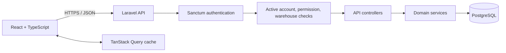

# System architecture

This document describes the current application boundaries and the invariants that should be preserved when extending SystemAnchor. The Laravel routes, migrations, controllers, middleware, models, and services remain the source of truth; this guide is an orientation document, not a substitute for inspecting implementation.

## Components

### Frontend

The Vite application is under `frontend/`.

- `src/main.tsx` sets up routing and the persisted TanStack Query client.
- `src/Pages/` contains routed screens grouped by business area.
- `src/api/` contains API modules; `src/api/axios.ts` configures the API base URL, bearer token, timeout, and unauthorized-session handling.
- `src/hooks/` contains query and shared UI hooks.
- `src/lib/queryClient.ts` defines query keys; `src/lib/invalidate.ts` coordinates cache invalidation after mutations.
- `src/Pages/components/RequirePermission.tsx` and the sidebar provide client-side access UX. They do not replace server-side authorization.

Set `VITE_API_URL` to the API base URL including `/api`. If unset, the client uses `http://127.0.0.1:8000/api`.

### Backend

The Laravel application is under `backend/`.

- `routes/api.php` defines endpoint routes and route middleware.
- `app/Http/Controllers/Api/` contains request handling and response construction.
- `app/Http/Middleware/` contains active-account, permission, administrator, stock-movement, and warehouse access checks.
- `app/Services/InventoryService.php` is the shared stock-posting boundary.
- `app/Models/` contains Eloquent models and relationships.
- `database/migrations/` defines persistent schema and data changes; `database/seeders/` provides local sample/catalog data.
- `tests/Feature/` exercises API, authorization, and workflow behavior against PostgreSQL.

## Request and authorization flow

1. Login at `POST /api/login` returns a Sanctum token.
2. The frontend sends the token as `Authorization: Bearer <token>`.
3. Protected routes run Sanctum authentication and active-account middleware.
4. Route middleware checks the required permission. The Admin role receives full access through the permission middleware; administrator-only mutations additionally require the administrator middleware.
5. Controllers validate input and apply resource-level warehouse checks. A route permission alone does not grant access to records in unassigned warehouses.
6. Controllers/services persist changes and return JSON. The frontend invalidates affected query data after successful mutations.

Client route guards and hidden buttons are usability controls only. Every protected operation must be enforced by the API.

## Inventory and warehouse invariants

- `inventories` holds product quantity by warehouse. A product's aggregate `qty` is maintained for compatibility and is not sufficient to answer warehouse-specific availability.
- Inventory-changing operations must use `InventoryService` so balance changes and corresponding stock-movement ledger rows occur transactionally.
- Outbound operations must validate available quantity in the source warehouse. Transfers debit the source and credit the destination within the same transaction.
- Stock movement idempotency keys make a safe retry of the same operation a no-op; reusing a key for a different request is a conflict.
- Document completion should post its lines once and should preserve retry safety.
- Product visibility and quantities must respect each user's warehouse assignments unless their role or explicit account configuration grants all-warehouse access.

## Order workflows

- Purchase orders and sales orders record product lines and their associated warehouse.
- Goods receipt completion posts inbound lines to the receipt/order warehouse.
- Shipment creation posts outbound lines from the selected sales-order warehouse; delivery is a separate lifecycle action.
- Returns must be linked to shipped, unreturned quantities. Ambiguous legacy data must not be guessed to create eligibility.
- Workflow status transitions and valid line quantities are enforced by backend controllers/services, even when the frontend filters dropdown options.

## Data and migration policy

PostgreSQL is the supported application and automated-test database. Migrations are the schema history; do not modify an already released migration to change its behavior. Add a corrective forward migration instead. Rehearse destructive or identifier-changing migrations against a restored, isolated database and reconcile dependent references before release. See [MIGRATION_RUNBOOK.md](../MIGRATION_RUNBOOK.md).
